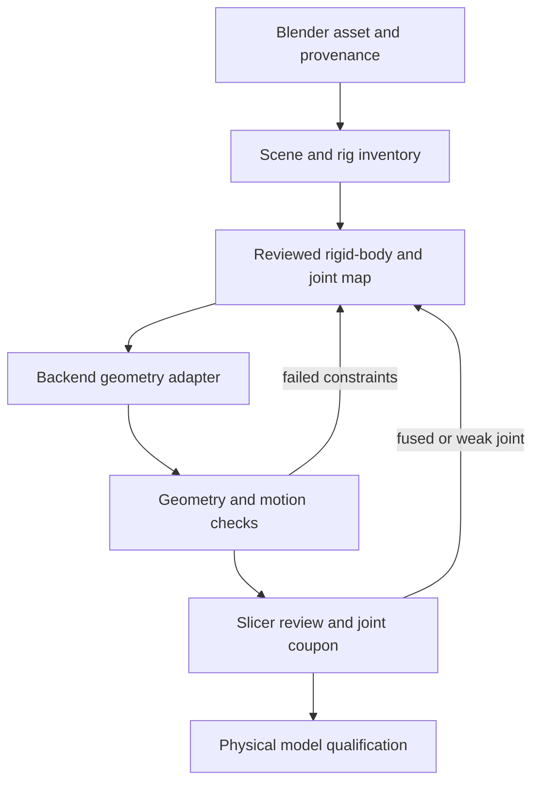

# Architecture and scope

## Intended workflow

Only the scene inventory and plan-contract checks are implemented in the bootstrap. Geometry adapters and downstream gates are planned.

## Boundaries

- **Blender adapter:** inspect evaluated meshes and rig metadata; identify visible versus helper objects; confirm units, pose, modifiers and instance handling. Do not overwrite the original `.blend`. Rig endpoints are hints, not automatic mechanical anchor locations.
- **Mechanical plan:** explicit rigid bodies, parent/child pairs, hinge or ball joint, world-space anchor and axis, motion limits, one-sided clearance, wall target, retention method, and print orientation/support strategy. Keep manual corrections reviewable. Body splitting may use existing objects, weights or user-marked cuts; ambiguous mixed weights require review.
- **Geometry adapter:** initially compare existing open-source backends. Fuse each joint feature into its own intended rigid body, remove original material that crosses joints, and preserve gaps between moving bodies. Fail visibly on Boolean or segmentation errors.
- **Validation:** distinguish closed solids from a single shell. A print-in-place assembly normally has multiple disconnected mesh components in one STL. Check self-intersections, wall thickness, attachment, minimum distances, retention and motion across each joint's requested range. Sampled motion checks are not continuous collision proofs.
- **Packaging:** one assembled-in-place STL plus source `.blend`, plan and validation reports. STL does not encode units or the joint graph; sidecar metadata is required. Add 3MF after the STL workflow is qualified.
- **Physical qualification:** profile-specific evidence, not a universal printable badge. No generated G-code or automatic printer dispatch in the initial scope.

## Ferris first, generalization second

Start with one limb attachment and a captive joint coupon. Preserve the body silhouette, claws and branch topology where the available volume permits. Simplify or omit unmanufacturable motion explicitly. Do not require every animation bone to become a physical joint. Scale the body first and regenerate physical joints at their millimetre sizes; scaling a finished STL also scales its clearance.

An initial FDM workflow may need pose changes, larger joint housings or fewer degrees of freedom. A follow-on example with a different skeleton is required before claiming general conversion support.

## Evidence contract

Each candidate records source revision and SHA-256, Blender/backend versions, target scale, all parameters, output hashes, validator output, slicer version/profile, and physical observations if any. Use separate statuses: `unrun`, `pass`, `fail`, `review`. Do not convert an unavailable check into a pass. A plan can pass its structural checker while its geometry still fails.

## Tooling references

- [Blender command-line options](https://docs.blender.org/manual/en/4.2/advanced/command_line/arguments.html): embedded script auto-execution control and Python failure exit code.
- [Blender dependency graph API](https://docs.blender.org/api/current/bpy.types.Depsgraph.html): evaluated mesh inspection.
- [Prior work and upstream decisions](existing-projects.md).
